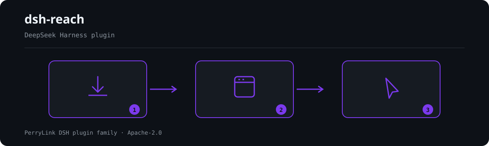

# dsh-reach

[](LICENSE)
[](https://github.com/topics/dsh-plugin)
[](https://github.com/PerryLink/dsh-plugin-doctor#verified-徽章)
[](https://dsh.market/)
[](https://gitee.com/perrylink/dsh-reach)
[](https://github.com/PerryLink/dsh-reach/actions)
[](https://github.com/PerryLink/dsh-reach/releases)
[](https://www.npmjs.com/package/dsh-reach)
[](https://www.npmjs.com/package/dsh-reach)
[](https://dshfind.com/es/plugins/PerryLink/dsh-reach?ref=badge)

[English](README.md) | [简体中文](README-zh.md) | **Español** | [Português](README-pt.md) | [हिन्दी](README-hi.md)

```sh
dsh plugin --profile <name> add dsh-reach
```


Puente multicanal de decisiones y control remoto para [DeepSeek Harness](https://github.com/deepseek-ai/deepseek-harness) (DSH): envía las tarjetas de aprobación/pregunta de cualquier espacio de trabajo a canales IM (WeChat iLink, Telegram, Feishu — más las bases v2 de QQ/DingTalk/WeCom) y permite responderlas desde el chat, con consola de sesión, seguridad por canal y un servicio abierto de notificaciones.

> **Estado: Fases 1–3 completas (canales WeChat + Telegram + Feishu, v0.1.22); bases de canales v2 (QQ/DingTalk/WeCom) sobre el registro abierto `reachChannels`.**
> El plan de diseño, la investigación de la competencia, la verificación de
> contratos oficiales y la hoja de ruta están en
> [`docs/design/03-rebuild-direction-and-plan.md`](docs/design/03-rebuild-direction-and-plan.md).


**📖 Base de conocimiento del ecosistema** — datos medidos, no marketing: [guía de desarrollo · datos de selección · criterios de mantenimiento](https://perrylink.github.io/dsh-plugin-guide/).

<!-- star-cta -->

## Install

```bash
npx @deepseek-ai/dsh plugin --profile web add dsh-reach
dsh1024 plugin --profile web add dsh-reach
```

Reinicia DSH tras la instalación (los parches del bundle se aplican al arrancar).

## What is dsh-reach?

Evidencia completa: `dsh-plugin-supersession-review-20261005.md`. Texto completo en la sección **Maintenance status: 🧊 FROZEN** de [README.md](README.md).



*Resumen del flujo: instalar → abrir panel → actuar. Los ejemplos siguientes usan la superficie de comandos real.*


*La misma ejecución, animada.*

## Estado de mantenimiento: 🧊 CONGELADO

> **Congelado el 2026-10-05. Sin nuevas funciones.** Este paquete sigue funcionando y **no está retirado**, pero ya no recibe trabajo de funciones; solo se corregirá una avería real.

Los mantenedores consideran que en esta capacidad **ya existen alternativas con mejor adopción**, así que el esfuerzo se ha trasladado. Comparativa medida el 2026-10-05:

| | paquete | descargas semanales |
|---|---|---|
| **este paquete** | `dsh-reach` | 600 |
| alternativa mejor adoptada | [`@xmanrui/dsh-im`](https://github.com/xmanrui/dsh-im) | **17,384** |

👉 **Para trabajo nuevo, prefiera @xmanrui/dsh-im.** Las instalaciones existentes siguen funcionando sin cambios.

*Evidencia completa: `dsh-plugin-supersession-review-20261005.md`. Texto completo en la sección **Maintenance status: 🧊 FROZEN** de [README.md](README.md).*

## ⭐ 如果它帮到了你

Este plugin forma parte de la [familia de plugins DSH](https://github.com/PerryLink) (más de 40, todos Apache-2.0). Si te resulta útil, **dale una estrella**: no desbloquea nada, pero ayuda a que la siguiente persona lo encuentre antes.

*English:* part of a 95 plugin family for DeepSeek Harness. If it is useful, **a star helps the next person find it** — nothing is gated behind it.
## Compatibilidad

| Superficie | Estado |
|---|---|
| Harness | DeepSeek Harness **dsh-v0.2.1-alpha.1** (tag de GitHub). Rango de peers `>=0.1.2-rc.1 <0.2.0 \|\| >=0.1.5-alpha.1 <0.2.0 \|\| >=0.1.6-0 <0.2.0 \|\| >=0.1.7-0 <0.2.0`; los pines de dev/test se mantienen a propósito en la línea publicada `0.1.7-rc.2`, que es la cara que mide la regla `typecheck:ci` (la regla `typecheck` mide el checkout a través de los `paths` de `tsconfig.json`). Verificado el 2026-09-24 con la cadena completa de gates; el smoke de bare-import + perfil scratch + keyless corre en el workflow Compat en cada PR. |
| Node | `^22.19.0 \|\| >=24.0.0` |

## Features (Phase 1)

```sh
dsh plugin --profile web add github:PerryLink/dsh-reach
```

- Tarjetas de decisión de cualquier espacio de trabajo enviadas a WeChat con numeración estable; respuesta con `1`/`2`, `P1=1 P2=2` o `/rp` `/rq`.
- Seguridad fail-closed: el primer remitente es el propietario; listas vacías niegan a todos.
- Consola de sesión (`/reach /help /status /silent /notify /tasks /enter /workspace /session /preset /model /perm /history /stop /next`) y pestaña de ajustes.

### Ejemplos

Son los puntos de entrada reales; instala y llama a uno.

#### Ejemplo detallado

**Comando**

~~~sh
/rp
~~~

**Salida**

~~~text
已拒绝 2 张权限卡。
~~~

*Observado en `tests/bridge.spec.ts:167-174; src/bridge.ts:594-598`*

#### Rama de fallo

**Entrada**

~~~text
/rp while 2 approval cards are pending
~~~

**Salida**

~~~text
已拒绝 2 张权限卡。
~~~

*Observado en `plugins/dsh-reach/tests/bridge.spec.ts:167-174; plugins/dsh-reach/src/bridge.ts:594-598; plugins/dsh-reach/README.md:121-136`*

#### Ejemplos breves

- `/rq`

## Configuration

| Clave | Valor por defecto | Descripción |
|---|---|---|
| `crossSessionNotify` | `true` | Envía tarjetas de decisión desde CUALQUIER espacio de trabajo/sesión |
| `notifyTaskEvents` | `false` | Notificaciones de tareas en segundo plano terminadas/fallidas |
| `cardTimeoutSec` | `1800` | Tiempo de espera suave de las tarjetas en segundos (`0` = indefinido) |
| `textChunkLimit` | `4000` | Límite de caracteres por fragmento de respuesta larga |
| `silent` | `false` | Solo respuestas finales, sin streaming por pasos |
| `cwd` | `''` | Directorio de trabajo por defecto para sesiones IM nuevas |
| `authCode` | `''` | Shared secret the IM side must present before a message is accepted |
| `digestSec` | `300` | Digest window in seconds (`0` disables the digest) |
| `pushToken` | `''` | Token for the open push service (`reach_send` HTTP surface) |
| `telegramToken` | `''` | Telegram bot token for the Telegram channel |

## Development

```bash
pnpm install
pnpm run typecheck && pnpm run typecheck:ci && pnpm test
pnpm run build && pnpm run verify:self-contained && pnpm run verify:artifacts
pnpm run check:readmes && pnpm pack
```

### Instalar desde el mercado de DSH Desktop

Todos los plugins de PerryLink pueden explorarse en el mercado integrado de DSH Desktop: **Market → Sources → add source → pegar** `https://perrylink-dsh-catalog.perrylink.workers.dev/catalog-source.json` **→ seleccionarlo**. La instalación sigue pasando por la verificación de identidad npm del mercado y tu confirmación.

## Interoperability with other DSH plugins

Verificado contra **DSH `0.2.0-rc.2`** (el runtime para el que se publica este README) y el conjunto de plugins con más estrellas sondeado el 2026-10-05.

Este plugin **no interfiere** con otros plugins, incluidos los de más estrellas:

- **Sin colisión de nombres de herramienta.** Todas las herramientas llevan espacio de nombres; ninguna ocupa un nombre desnudo ya perteneciente a una herramienta incluida u otro plugin.
- **Sin colisión de clave de servicio.** Solo provee `reach`, `reachChannels`, `reachPush`; esa clave no es una costura incluida ni la provee ningún plugin de más estrellas.
- **Sin colisión de slot.** No registra ninguna clave de slot de cliente, así que no disputa un asiento `shadows-shipped-ui`.
- **Sin colisión de ruta HTTP.** No registra ningún prefijo `webServer`.
- **Sin colisión en la capa de patch.** El patch del bundle solo hace `insert` de su propia fila; nunca sobrescribe el `config` de una fila incluida.
- **Sin mutación global.** No parchea prototipos, ni reescribe `process.env`, ni reemplaza el dispatcher global de fetch.

**Los listeners de eventos compartidos no interfieren por construcción.** Observa los eventos sensibles al orden `approval/request`, `user-questions/request` con `ctx.on()` — el registro de difusión de Cordis, donde cada listener se ejecuta y ninguno puede dejar sin turno a otro. **Todos los listeners aquí delegan por `next()`**, así que la cadena nunca se cortocircuita:

Evidencia estática: `dsh-plugin-doctor` K10–K13 dan `pass` en todas las comprobaciones de este repositorio.

## PerryLink DSH Plugin Family

Este proyecto forma parte de la familia de plugins de DeepSeek Harness de [PerryLink](https://github.com/PerryLink). El registro permanece plegado abajo para que cada README conserve una primera pantalla corta; expándelo para ver cada fila y su estado.

<details>
<summary>Expandir todos los plugins</summary>

| Plugin | Estado |
|---|---|
| **[dsh-aqua-input-check](https://github.com/PerryLink/dsh-aqua-input-check)** |  |
| **[dsh-archive-check](https://github.com/PerryLink/dsh-archive-check)** |  |
| **[dsh-auto-review](https://github.com/PerryLink/dsh-auto-review)** |  |
| **[dsh-autotier](https://github.com/PerryLink/dsh-autotier)** |  |
| **[dsh-bid-ca-precheck](https://github.com/PerryLink/dsh-bid-ca-precheck)** |  |
| **[dsh-bid-qual-check](https://github.com/PerryLink/dsh-bid-qual-check)** |  |
| **[dsh-cert-mcp](https://github.com/PerryLink/dsh-cert-mcp)** |  |
| **[dsh-checkpoint-rewind](https://github.com/PerryLink/dsh-checkpoint-rewind)** |  |
| **[dsh-click](https://github.com/PerryLink/dsh-click)** |  |
| **[dsh-composer-history](https://github.com/PerryLink/dsh-composer-history)** |  |
| **[dsh-contract-stance](https://github.com/PerryLink/dsh-contract-stance)** |  |
| **[dsh-customs-doc-check](https://github.com/PerryLink/dsh-customs-doc-check)** |  |
| **[dsh-data-quality](https://github.com/PerryLink/dsh-data-quality)** |  |
| **[dsh-demurrage-ledger](https://github.com/PerryLink/dsh-demurrage-ledger)** |  |
| **[dsh-doublecheck](https://github.com/PerryLink/dsh-doublecheck)** |  |
| **[dsh-drill-script-check](https://github.com/PerryLink/dsh-drill-script-check)** |  |
| **[dsh-eia-guide-check](https://github.com/PerryLink/dsh-eia-guide-check)** |  |
| **[dsh-emergency-plan](https://github.com/PerryLink/dsh-emergency-plan)** |  |
| **[dsh-essay-rubric-check](https://github.com/PerryLink/dsh-essay-rubric-check)** |  |
| **[dsh-evidence-check](https://github.com/PerryLink/dsh-evidence-check)** |  |
| **[dsh-export-ctl-check](https://github.com/PerryLink/dsh-export-ctl-check)** |  |
| **[dsh-fast](https://github.com/PerryLink/dsh-fast)** |  |
| **[dsh-fmea-table-check](https://github.com/PerryLink/dsh-fmea-table-check)** |  |
| **[dsh-forecast-penalty](https://github.com/PerryLink/dsh-forecast-penalty)** |  |
| **[dsh-fund-research](https://github.com/PerryLink/dsh-fund-research)** |  |
| **[dsh-github](https://github.com/PerryLink/dsh-github)** |  |
| **[dsh-gongwen-flow-check](https://github.com/PerryLink/dsh-gongwen-flow-check)** |  |
| **[dsh-gongwen-word-check](https://github.com/PerryLink/dsh-gongwen-word-check)** |  |
| **[dsh-guard-plan-qc](https://github.com/PerryLink/dsh-guard-plan-qc)** |  |
| **[dsh-hazchem-check](https://github.com/PerryLink/dsh-hazchem-check)** |  |
| **[dsh-hazplan-check](https://github.com/PerryLink/dsh-hazplan-check)** |  |
| **[dsh-hidden-risk-map](https://github.com/PerryLink/dsh-hidden-risk-map)** |  |
| **[dsh-hs-classify](https://github.com/PerryLink/dsh-hs-classify)** |  |
| **[dsh-icd-rule-check](https://github.com/PerryLink/dsh-icd-rule-check)** |  |
| **[dsh-industry-research](https://github.com/PerryLink/dsh-industry-research)** |  |
| **[dsh-lawcite-adapter](https://github.com/PerryLink/dsh-lawcite-adapter)** |  |
| **[dsh-laya](https://github.com/PerryLink/dsh-laya)** |  |
| **[dsh-lc-doc-check](https://github.com/PerryLink/dsh-lc-doc-check)** |  |
| **[dsh-learning-gap-check](https://github.com/PerryLink/dsh-learning-gap-check)** |  |
| **[dsh-library](https://github.com/PerryLink/dsh-library)** |  |
| **[dsh-local-ai](https://github.com/PerryLink/dsh-local-ai)** |  |
| **[dsh-lsp-actions](https://github.com/PerryLink/dsh-lsp-actions)** |  |
| **[dsh-mask](https://github.com/PerryLink/dsh-mask)** |  |
| **[dsh-mcp-panel](https://github.com/PerryLink/dsh-mcp-panel)** |  |
| **[dsh-medrec-qc](https://github.com/PerryLink/dsh-medrec-qc)** |  |
| **[dsh-memento](https://github.com/PerryLink/dsh-memento)** |  |
| **[dsh-nsfc-form-check](https://github.com/PerryLink/dsh-nsfc-form-check)** |  |
| **[dsh-nurse-record-check](https://github.com/PerryLink/dsh-nurse-record-check)** |  |
| **[dsh-observe](https://github.com/PerryLink/dsh-observe)** |  |
| **[dsh-origin-rvc-check](https://github.com/PerryLink/dsh-origin-rvc-check)** |  |
| **[dsh-ota-review-check](https://github.com/PerryLink/dsh-ota-review-check)** |  |
| **[dsh-output-styles](https://github.com/PerryLink/dsh-output-styles)** |  |
| **[dsh-paper-doc-adapter](https://github.com/PerryLink/dsh-paper-doc-adapter)** |  |
| **[dsh-permission-rules](https://github.com/PerryLink/dsh-permission-rules)** |  |
| **[dsh-permit-report-check](https://github.com/PerryLink/dsh-permit-report-check)** |  |
| **[dsh-pipeline-check](https://github.com/PerryLink/dsh-pipeline-check)** |  |
| **[dsh-pleading-draft](https://github.com/PerryLink/dsh-pleading-draft)** |  |
| **[dsh-plugin-doctor](https://github.com/PerryLink/dsh-plugin-doctor)** |  |
| **[dsh-plugin-guide](https://github.com/PerryLink/dsh-plugin-guide)** |  |
| **[dsh-plugin-kit](https://github.com/PerryLink/dsh-plugin-kit)** |  |
| **[dsh-plugin-upgrade](https://github.com/PerryLink/dsh-plugin-upgrade)** |  |
| **[dsh-policy-brief-draft](https://github.com/PerryLink/dsh-policy-brief-draft)** |  |
| **[dsh-power-loss-split](https://github.com/PerryLink/dsh-power-loss-split)** |  |
| **[dsh-power-ticket-check](https://github.com/PerryLink/dsh-power-ticket-check)** |  |
| **[dsh-ppap-check](https://github.com/PerryLink/dsh-ppap-check)** |  |
| **[dsh-protest-deadline](https://github.com/PerryLink/dsh-protest-deadline)** |  |
| **[dsh-railway-window](https://github.com/PerryLink/dsh-railway-window)** |  |
| **[dsh-repair-order-qc](https://github.com/PerryLink/dsh-repair-order-qc)** |  |
| **[dsh-research-report](https://github.com/PerryLink/dsh-research-report)** |  |
| **[dsh-review-reply-check](https://github.com/PerryLink/dsh-review-reply-check)** |  |
| **[dsh-rulefile-check](https://github.com/PerryLink/dsh-rulefile-check)** |  |
| **[dsh-safety-brief-check](https://github.com/PerryLink/dsh-safety-brief-check)** |  |
| **[dsh-score](https://github.com/PerryLink/dsh-score)** |  |
| **[dsh-session-sync](https://github.com/PerryLink/dsh-session-sync)** |  |
| **[dsh-site-log-check](https://github.com/PerryLink/dsh-site-log-check)** |  |
| **[dsh-skill-pack-security](https://github.com/PerryLink/dsh-skill-pack-security)** |  |
| **[dsh-soe-decision-check](https://github.com/PerryLink/dsh-soe-decision-check)** |  |
| **[dsh-soilwater-check](https://github.com/PerryLink/dsh-soilwater-check)** |  |
| **[dsh-sop-sync-check](https://github.com/PerryLink/dsh-sop-sync-check)** |  |
| **[dsh-spc-gbt-adapter](https://github.com/PerryLink/dsh-spc-gbt-adapter)** |  |
| **[dsh-talk](https://github.com/PerryLink/dsh-talk)** |  |
| **[dsh-tender-extract](https://github.com/PerryLink/dsh-tender-extract)** |  |
| **[dsh-tender-matrix](https://github.com/PerryLink/dsh-tender-matrix)** |  |
| **[dsh-test-drive](https://github.com/PerryLink/dsh-test-drive)** |  |
| **[dsh-ticktick](https://github.com/PerryLink/dsh-ticktick)** |  |
| **[dsh-translate](https://github.com/PerryLink/dsh-translate)** |  |
| **[dsh-warranty-calc](https://github.com/PerryLink/dsh-warranty-calc)** |  |
| **[dsh-budget](https://github.com/PerryLink/dsh-budget)** | 🧊 CONGELADO — ver el README del repositorio |
| **[dsh-claude-move](https://github.com/PerryLink/dsh-claude-move)** | 🧊 CONGELADO — ver el README del repositorio |
| **[dsh-defend](https://github.com/PerryLink/dsh-defend)** | 🧊 CONGELADO — ver el README del repositorio |
| **[dsh-draw](https://github.com/PerryLink/dsh-draw)** | 🧊 CONGELADO — ver el README del repositorio |
| **[dsh-reach](https://github.com/PerryLink/dsh-reach)** | 🧊 CONGELADO — ver el README del repositorio |
| **[dsh-background-agents](https://github.com/PerryLink/dsh-background-agents)** | 🚫 RETIRADO — ver el README del repositorio |
| **[dsh-session-pin](https://github.com/PerryLink/dsh-session-pin)** | 🚫 RETIRADO — ver el README del repositorio |
| **[dsh-team-rooms](https://github.com/PerryLink/dsh-team-rooms)** | 🚫 RETIRADO — ver el README del repositorio |

</details>

## License

Apache-2.0. Avisos de terceros en [THIRD_PARTY_NOTICES.md](THIRD_PARTY_NOTICES.md).
